<a href="https://faazkhan.in"></a>

  
  
  
  

I'm a Computer Science student at MIT World Peace University, Pune. I build AI that holds up when you test it: a simulated psychiatric
patient whose decisions are made in code you can read, an agentic debugger that only accepts fixes the sanitizer passes, and a cyclone
forecaster that came 3rd in India.

## Now building: Rapport

**[Rapport](https://github.com/faazkhn/Rapport)** lets a medical student talk out loud to a 3D psychiatric patient who answers with a
voice, a face and body language, all on one laptop. The patient's mind, the **Digital Twin**, is ordinary code. It decides what she
remembers, how much she trusts you and what she's allowed to say, and one on-device language model only puts that decision into words.

<a href="https://github.com/faazkhn/Rapport"></a>

Two journal manuscripts with Prof. Sanket Salvi (MIT-WPU):

- *Recognising Reworded Risk Questions in a Simulated Psychiatric Patient: A Blind Benchmark, Small Encoders, BM25 and a Zero-Shot
  Language Model*, submitted to the Journal of Healthcare Informatics Research.
- *Decide in Code, Voice with the Model: A Code-Governed Patient Model for an On-Device Psychiatric Standardised Patient, Compared with a
  Prompt-Only Baseline*, prepared for the Journal of Medical Systems.

[Code](https://github.com/faazkhn/Rapport) · [Site](https://rapport.faazkhan.in) · [Film](https://www.youtube.com/watch?v=G7NP5U4vXLs)
(the patient's replies are pre-scripted for filming) · 

<a href="https://prevista.faazkhan.in"></a>

## Shipped

  <a href="https://github.com/faazkhn/cyclone-sentinel"></a>
  <a href="https://github.com/faazkhn/segsense"></a>
  <a href="https://github.com/faazkhn/allowance"></a>
  <a href="https://github.com/faazkhn/Huddle"></a>
  <a href="https://github.com/faazkhn/hivemind"></a>
  <a href="https://github.com/faazkhn/ridetaste"></a>
  <a href="https://github.com/faazkhn/nasweep"></a>
  <a href="https://github.com/faazkhn/ScanForge"></a>

The hackathon projects were built as a team with Akanksha Singh, Ishaan Singh and Arnav Mankawade. More on each at
[faazkhan.in](https://faazkhan.in).

## Recognition

| | |
|---|---|
| **3rd in India** (2nd runner-up, of 2,500+) | Google Build with AI: Code for Communities, 2nd edition, with CycloneSentinel |
| **1st prize** | India Tech Summit 2026 |
| **1st place** | AEON 2025 AI/ML competition (CNN on MNIST, 99.73% validation accuracy) |
| **Tebex Legends Bronze** | SkyLoom Network's store |
| **Oracle certified** | OCI 2025 AI Foundations Associate · Fusion AI Agent Studio Foundations Associate |
| **CGPA 9.05 / 10** | B.Tech Computer Science and Engineering, MIT World Peace University (2025–2029) |

## Experience

| When | Where | What |
|---|---|---|
| Oct 2026 – now | **Rapport** | Research under faculty mentorship at MIT-WPU: the Digital Twin, a blind 512-question benchmark, two manuscripts |
| Oct 2026 – now | **Prevista** | Founder, with Prof. Sanket Salvi as co-founder and faculty mentor: true-to-scale VR home tours |
| Jun – Nov 2026 | **SkyLoom Network** | Founder: a game-server network and its Next.js store, about US$3,000 in revenue in five months |
| Nov 2024 – Jun 2026 | **BendersMC** | Junior Developer → Developer → Senior Developer → Head Developer (Development Supervisor): promoted three times in under 19 months, responsible for every Java project on a network with a 140,000-member community |
| 2024 – now | **Freelance** | Java developer: custom server software for 25+ client servers and a creator with 21k subscribers, each delivered in 72 hours to a week; formerly Dev Manager at Loony Studios |

## Toolbox

  

LLM agents and tool use · embeddings and retrieval · speech (ASR, TTS) · pose estimation · CNNs · OpenXR ·
evaluation design (held-out splits, ablations, bootstrap intervals)

## Activity

<picture>
  <source media="(prefers-color-scheme: dark)" srcset="https://raw.githubusercontent.com/faazkhn/faazkhn/output/snake-dark.svg">
  
</picture>

